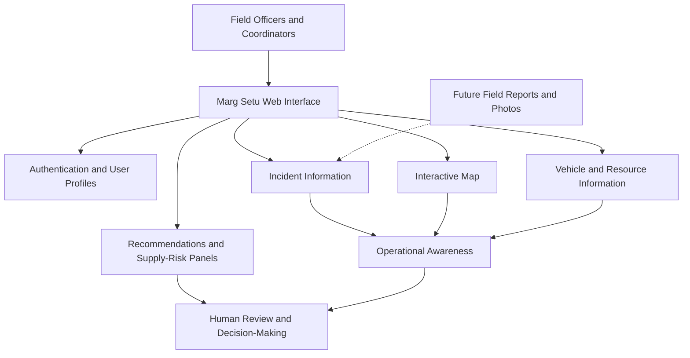

# Marg Setu — Disaster Response & Route Coordination Platform

**A web-based disaster management dashboard designed to support situational awareness, route monitoring, incident coordination, and emergency resource planning.**

Marg Setu aims to help disaster-response teams understand developing situations, identify reported incidents, monitor response resources, and make better-informed decisions during emergencies, with an initial focus on the challenging terrain and connectivity conditions of Northeast India, particularly Sikkim and the Mangan region.

> **Project status:** Prototype / Active Development

---

## Table of Contents

- [Overview](#overview)
- [The Problem](#the-problem)
- [Our Solution](#our-solution)
- [Key Features](#key-features)
- [How It Works](#how-it-works)
- [Glimpse of our Website](#Website)
- [Technology Stack](#technology-stack)
- [System Architecture](#system-architecture)
- [Getting Started](#getting-started)
- [Running in GitHub Codespaces](#running-in-github-codespaces)
- [Project Structure](#project-structure)
- [Current Scope and Limitations](#current-scope-and-limitations)
- [Future Roadmap](#future-roadmap)
- [Potential Impact](#potential-impact)
- [Contributing](#contributing)
- [License](#license)

---

## Overview

During natural disasters such as landslides, flash floods, and severe weather events, emergency responders must make decisions with incomplete and rapidly changing information. Damaged roads, isolated communities, limited resources, and communication difficulties can make coordination even more challenging.

**Marg Setu is a disaster-response coordination dashboard intended to bring essential operational information into one interface.**

The platform combines an interactive map, incident information, response-resource visibility, and decision-support panels to help users understand the situation and plan their next actions.

Rather than treating incident reporting, route awareness, and resource coordination as separate activities, Marg Setu aims to connect them within a unified web-based workspace.

### Our vision

To make disaster-response coordination more accessible, organized, and informed through a simple digital platform that can evolve to support field officers, emergency coordinators, and relief teams.

## The Problem

Disaster management involves several interconnected challenges:

- **Limited situational awareness:** Responders may struggle to obtain a clear overview of incidents across affected areas.
- **Route uncertainty:** Landslides, flooding, and damaged infrastructure can make previously usable roads unsafe or inaccessible.
- **Fragmented information:** Incident reports, response vehicles, and supply information may be maintained separately.
- **Resource allocation:** Emergency teams need to understand where resources may be required and which priorities need attention.
- **Field-to-dashboard communication:** Information collected by field officers needs a structured way to reach decision-makers.
- **Regional accessibility:** A useful disaster-response interface should be designed with local operating conditions and language accessibility in mind.

These challenges highlight the need for a common operational view that can help teams organize information and coordinate their response.

## Our Solution

Marg Setu provides a centralized web dashboard that brings together map-based situational awareness, incident monitoring, response-resource information, and decision-support components.

The current prototype is being developed around a React-based interface with Firebase integration and OpenStreetMap-based mapping.

The intended workflow is straightforward:

1. Authorized users access the dashboard.
2. Users review the mapped situation and available incident information.
3. Response teams examine available vehicle and resource information.
4. Recommendation and supply-risk panels help organize operational priorities.
5. Field-collected information can be incorporated as the reporting workflow develops.

Marg Setu is a **decision-support and coordination prototype**. It is intended to assist human responders, not replace their judgment or independently guarantee safe routes.

## Key Features

### 1. Interactive Disaster Map

Provides a geographic view for understanding incident locations and the surrounding operational area.

- Map-based situational awareness using OpenStreetMap.
- A dedicated map view integrated into the main dashboard.
- Visual context for reviewing reported incidents and affected areas.
- A foundation for future route-condition and accessibility overlays.

### 2. Incident Monitoring

Organizes incident-related information so users can review reported situations from the dashboard.

- Dedicated incident panel.
- Centralized presentation of incident information.
- A foundation for prioritizing reports and monitoring changing conditions.

The availability of live incident feeds and automated incident detection depends on future integrations.

### 3. Response Vehicle Overview

Provides a dedicated interface for reviewing vehicle or response-resource information.

- Vehicle list and resource visibility.
- A dashboard-level view of available operational information.
- A foundation for future assignment and dispatch workflows.

Live GPS tracking and automated dispatch should be considered future capabilities unless separately implemented.

### 4. Recommendation Panel

Provides a dedicated space for presenting operational recommendations.

The goal is to help users organize decisions using available incident, route, and resource information. The quality of recommendations depends on the data and decision logic connected to the panel.

### 5. Supply-Risk Awareness

Includes a supply-risk dashboard component intended to support awareness of potential resource and supply concerns.

This creates a foundation for future capabilities such as identifying shortages, monitoring essential supplies, and highlighting areas requiring relief support.

### 6. Authentication and User Profiles

Firebase integration supports the prototype's authentication and user-profile workflow.

- Login interface.
- Authenticated dashboard access.
- User-profile and role-related interface elements.
- Logout and return-to-login workflow.

Role-based authorization must also be enforced by the backend and relevant data-access rules, not just by hiding interface elements.

### 7. Field Reporting — Planned Expansion

A planned enhancement is to allow field officers to submit photographs and on-site information.

This could help connect ground-level observations with the central dashboard and improve the information available to coordinators.

### 8. Multilingual Accessibility — Planned Expansion

Future development aims to support English, Hindi, and a relevant regional language for Sikkim.

The objective is to make the platform easier to use for people operating in different linguistic contexts.

---

## How It Works

The following diagram illustrates the intended information flow. It describes the platform's design direction rather than claiming that every integration is already implemented.



### Typical user journey

**Access → Observe → Assess → Coordinate**

- **Access:** Sign in to the application.
- **Observe:** Review the map and available incident information.
- **Assess:** Examine vehicle, resource, recommendation, and supply-risk panels.
- **Coordinate:** Use the available information to support response planning.

The dashboard is designed to bring these activities together in a single interface.

## Website


## Technology Stack

| Technology        | Purpose                                        |
| ----------------- | ---------------------------------------------- |
| React             | Building reusable user-interface components    |
| Vite              | Frontend development server and build tooling  |
| JavaScript / JSX  | Application logic and interface implementation |
| Firebase          | Authentication and related backend integration |
| OpenStreetMap     | Map data and geographic visualization          |
| CSS               | Styling and responsive layout                  |
| GitHub Codespaces | Cloud-based development environment            |

The precise libraries and versions should be confirmed against the project's `package.json` and configuration files.

## System Architecture

Marg Setu follows a component-oriented frontend structure.

### Frontend layer

The React application contains the login experience, dashboard layout, map, incident information, vehicle information, and decision-support panels.

### Authentication and backend layer

Firebase is used for authentication and related integration. Data storage, access policies, and any additional backend services should be documented according to the actual configuration in the repository.

### Mapping layer

OpenStreetMap provides the underlying geographic map context. Additional route-condition data, incident overlays, and live traffic or road-status feeds would require suitable data sources and integration.

### Decision-support layer

Recommendation and supply-risk components provide a place to present operational information. Their actual capabilities depend on the rules, data inputs, and services implemented behind them.

---

## Getting Started

Follow these steps to run the project locally.

### Prerequisites

Install or have access to:

- Git
- Node.js and npm
- A GitHub account if using Codespaces
- Firebase project configuration if required by the current application

### 1. Clone the repository

```bash
git clone https://github.com/Alliedbeast/MargSetu.git
cd MargSetu
```

### 2. Install dependencies

```bash
npm install
```

### 3. Configure Firebase

If the application requires Firebase configuration:

1. Open the Firebase configuration file in the project.
2. Identify the configuration values and environment-variable names expected by the application.
3. Supply the required values using the existing project configuration.
4. If environment variables are used, create a local `.env` file using the names expected by the code.

For example, if the application is configured to use Vite environment variables, the format may look like this:

```dotenv
VITE_FIREBASE_API_KEY=your_api_key
VITE_FIREBASE_AUTH_DOMAIN=your_auth_domain
VITE_FIREBASE_PROJECT_ID=your_project_id
```

These names are illustrative. **Use the actual variable names expected by this repository** and configure any additional required values.

Do not commit private service-account credentials, passwords, or other secrets. Firebase client configuration is not a substitute for properly configured authentication and database security rules.

### 4. Start the development server

```bash
npm run dev
```

Open the local URL printed in the terminal, typically `http://localhost:5173`.

### 5. Build for production

```bash
npm run build
```

Vite normally writes the production build to the `dist/` directory.

To preview the production build locally, run:

```bash
npm run preview
```

For the exact available commands, check the `scripts` section of `package.json`.

---

## Running in GitHub Codespaces

Marg Setu can be developed in GitHub Codespaces without installing the full development environment on your computer.

1. Open the [Marg Setu repository](https://github.com/Alliedbeast/MargSetu).

2. Select **Code → Codespaces** and create or open a Codespace.

3. Open the terminal in the VS Code interface.

4. Install the dependencies:

   ```bash
   npm install
   ```

5. Start the development server:

   ```bash
   npm run dev -- --host 0.0.0.0
   ```

6. Open the **Ports** tab and use the browser link for port `5173` when it appears.

To check whether the application compiles successfully, run:

```bash
npm run build
```

If a command fails, inspect the terminal output and check that Node.js, dependencies, and required environment variables are configured correctly.

---

## Project Structure

The following is a conceptual overview of the main components used in the prototype. Confirm the exact paths and filenames against the repository before relying on this as a complete file tree.

```text
MargSetu/
├── public/                  # Public static assets, if present
├── src/
│   ├── components/
│   │   ├── MapView
│   │   ├── IncidentPanel
│   │   ├── VehicleList
│   │   ├── StatsRow
│   │   ├── MapLegend
│   │   ├── RecommendationPanel
│   │   └── SupplyRisk
│   ├── Login.jsx
│   ├── Dashboard.jsx
│   └── ...                  # Other application files
├── package.json
├── vite.config.js
└── README.md
```

### Main component responsibilities

| Component             | Responsibility                          |
| --------------------- | --------------------------------------- |
| `Login.jsx`           | Login interface and authentication flow |
| `Dashboard.jsx`       | Main operational dashboard              |
| `MapView`             | Geographic visualization                |
| `IncidentPanel`       | Incident information                    |
| `VehicleList`         | Vehicle and response-resource overview  |
| `StatsRow`            | Summary statistics                      |
| `MapLegend`           | Map-symbol explanations                 |
| `RecommendationPanel` | Operational recommendations             |
| `SupplyRisk`          | Supply-risk information                 |

Some filenames or directories may differ in the current repository.

---

## Current Scope and Limitations

Marg Setu is an evolving prototype. Its current scope should be distinguished from its longer-term vision.

| Area                   | Current direction        | Important limitation                                       |
| ---------------------- | ------------------------ | ---------------------------------------------------------- |
| Web dashboard          | React-based interface    | Requires further validation and refinement                 |
| Authentication         | Firebase integration     | Access policies must be verified                           |
| Mapping                | OpenStreetMap-based view | Map tiles alone do not establish current road safety       |
| Incidents              | Dashboard incident panel | Live external feeds may require additional integration     |
| Vehicles               | Vehicle-list component   | Live GPS and dispatch are not assumed                      |
| Recommendations        | Dedicated panel          | Reliability depends on implemented logic and input data    |
| Supply risks           | Dedicated panel          | Real inventory data and alert rules require integration    |
| Field reporting        | Planned enhancement      | Photo and on-site reporting workflow needs implementation  |
| Multilingual interface | Planned enhancement      | Regional-language support needs implementation and testing |

**Important:** Marg Setu is intended to support emergency coordination, not replace official emergency instructions, verified road closures, or decisions by trained responders. It should not be relied upon as a source of confirmed safe routes without validated and sufficiently current data.

---

## Future Roadmap

The following improvements represent potential next steps for the project.

- [ ] **Field reporting:** Allow field officers to submit incident details, photographs, and location information.
- [ ] **Live incident feeds:** Integrate verified sources for relevant disaster alerts and incident updates.
- [ ] **Route-condition awareness:** Display verified closures, hazards, and road-accessibility information.
- [ ] **Resource coordination:** Expand vehicle and relief-resource management workflows.
- [ ] **Supply monitoring:** Track essential supplies and flag potential shortages using reliable data.
- [ ] **Multilingual support:** Improve accessibility through English, Hindi, and a suitable regional language.
- [ ] **Mobile responsiveness:** Optimize the interface for field officers using phones and tablets.
- [ ] **Connectivity resilience:** Explore ways to preserve essential information during intermittent connectivity.
- [ ] **Security improvements:** Validate role-based access, data protection, and secure reporting workflows.
- [ ] **Testing and deployment:** Add automated tests, monitoring, and a reliable deployment pipeline.

These are planned improvements, not claims that the features are already available.

## Potential Impact

Marg Setu aims to contribute to more organized disaster-response workflows by:

- Improving visibility into incidents and affected areas.
- Bringing operational information into one dashboard.
- Supporting better-informed route and resource assessments.
- Providing a foundation for field-to-control-room communication.
- Making disaster-response tools more accessible to teams working in challenging regional conditions.

The platform's actual impact will depend on the reliability of its data sources, usability in field conditions, and validation with emergency-response stakeholders.

## Contributing

Contributions that improve usability, reliability, accessibility, security, and disaster-response workflows are welcome.

To contribute:

1. Fork the repository.
2. Create a feature branch.
3. Make your changes and test them.
4. Commit your work with a clear message.
5. Open a pull request explaining the change and its purpose.

For significant changes, consider discussing the proposed approach with the project maintainers first.

## License

A license has not been specified here because the repository's current license status has not been verified. Please check the repository for a `LICENSE` file and add the appropriate license information before distributing the project.

---

## Final Note

**Marg Setu is being developed as a practical step toward better disaster-response coordination.** By combining geographic awareness, incident information, resource visibility, and decision-support tools, the project aims to provide a foundation that can grow into a more capable and accessible emergency-management platform.

Built with the goal of helping responders make better-informed decisions when reliable information matters most.
