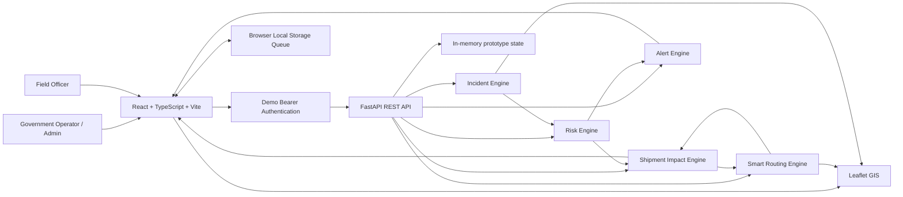

# Marg Setu — SIH26002

**AI-Based Smart Logistics and Accessibility Intelligence Platform for the North Eastern Region (NER)**

> **Observe → Predict → Decide → Reroute → Track → Learn**

Marg Setu is a logistics decision-support prototype for the North Eastern Region. It combines field incident intelligence, road-risk assessment, shipment impact analysis, GIS visualization, smart rerouting, alerts, vehicle monitoring, and operational analytics in one command center.

The current prototype uses a React + TypeScript frontend and a Python/FastAPI backend. The frontend communicates with authenticated API endpoints and the backend is the source of truth for dashboard, incident, risk, alert, vehicle, shipment, and route-approval state.

---

## 1. Problem Statement

The SIH26002 problem focuses on logistics and road accessibility in the North Eastern Region, where rainfall, landslides, flooding, road damage, bridge issues, limited connectivity, and fragmented operational information can disrupt movement.

A logistics operator needs more than a shortest path:

- Which roads are currently risky?
- Which vehicles are affected?
- Which shipments are affected?
- Which cargo is critical?
- Which alternative route is safer?
- What decision should an operator make?

Marg Setu addresses that chain as a single operational workflow.

---

## 2. What Marg Setu Demonstrates

### Core workflow

```text
Field Incident / Hazard
        ↓
FastAPI Incident Engine
        ↓
Risk Assessment
        ↓
Affected Shipment Identification
        ↓
Smart Route Recommendation
        ↓
Operator Approval
        ↓
Rerouted Shipment
        ↓
GIS + Alerts + Reports
```

### Current modules

| Module | Purpose |
|---|---|
| Command Center | Operational overview |
| Risk Intelligence | Live corridor risk + scenario simulator |
| GIS Map | Incidents, vehicles, corridors and approved route geometry |
| Field Incidents | Geo-tagged incident submission with offline queue |
| Alerts | Risk and field-event intelligence |
| Shipments | Impacted shipment monitoring |
| Vehicles | Fleet monitoring |
| Smart Rerouting | Risk-aware alternative route evaluation |
| Reports & Analytics | Operational evidence and exported reporting |
| SIH Demo Scenario | Controlled hazard-to-reroute demonstration |

---

## 3. Architecture



For the current prototype, route geometry is deterministic demonstration geometry. A production deployment can replace it with a real road-routing service such as OSRM/Valhalla/Mappls and persistent PostgreSQL/PostGIS storage.

---

## 4. Technology Stack

### Frontend

- React
- TypeScript
- Vite
- Leaflet / React Leaflet
- Lucide React
- Recharts
- CSS-based responsive UI

### Backend

- Python
- FastAPI
- Pydantic
- Uvicorn
- Bearer-token authentication for the prototype

### Current prototype storage

The current backend uses deterministic in-memory demo data for:

- incidents
- shipments
- vehicles
- approved reroutes
- corridors

The frontend also uses browser local storage for offline field-report queuing and compatibility caching.

---

## 5. Demo Credentials

### Admin

```text
Username: admin
Password: admin123
Role: Admin
```

### Field Officer

```text
Username: field
Password: field123
Role: Field Officer
```

### District Officer

```text
Username: district
Password: district123
Role: District Officer
```

> These are prototype/demo credentials only. Do not use them in a production deployment.

---

## 6. Prerequisites

Install:

- Python 3.10+
- Node.js 18+
- npm

Verify:

```powershell
python --version
node --version
npm --version
```

---

## 7. Run the Backend

Open PowerShell:

```powershell
cd D:\SIH26002-Marg-Setu\backend
```

Create/activate the virtual environment if needed:

```powershell
python -m venv venv
.\venv\Scripts\Activate.ps1
```

Install dependencies:

```powershell
pip install -r requirements.txt
```

Start FastAPI:

```powershell
python -m uvicorn app.main:app --reload --port 8000
```

Backend:

```text
http://127.0.0.1:8000
```

FastAPI documentation:

```text
http://127.0.0.1:8000/docs
```

Health check:

```text
http://127.0.0.1:8000/api/health
```

---

## 8. Run the Frontend

Open another PowerShell:

```powershell
cd D:\SIH26002-Marg-Setu\frontend
```

Install dependencies:

```powershell
npm install
```

Development server:

```powershell
npm run dev
```

Vite normally serves the application at:

```text
http://localhost:5173
```

Production build:

```powershell
npm run build
```

---

## 9. End-to-End Backend Smoke Test

From the project root:

```powershell
cd D:\SIH26002-Marg-Setu

powershell -ExecutionPolicy Bypass -File ".\smoke-test.ps1"
```

The smoke test verifies:

```text
Authentication
Dashboard
Incidents
Risk Engine
Alerts
Vehicles
Shipments
Route Recommendation
Route Geometry
Route Approval
Shipment Propagation
```

A successful run ends with:

```text
=============================================
          SMOKE TEST PASSED
=============================================

Authentication       : PASS
Dashboard            : PASS
Incidents            : PASS
Risk Engine          : PASS
Alerts               : PASS
Vehicles             : PASS
Shipments            : PASS
Route Recommendation : PASS
Route Geometry       : PASS
Route Approval       : PASS
Shipment Propagation : PASS

Marg Setu backend integration is operational.
```

---

## 10. SIH Demonstration Flow

Use this sequence during the presentation:

```text
1. Login
      ↓
2. Command Center
      ↓
3. Risk Intelligence
      ↓
4. Run SIH Demo Scenario
      ↓
5. Observe new risk + alerts
      ↓
6. Open Smart Rerouting
      ↓
7. Generate route alternatives
      ↓
8. Approve safer route
      ↓
9. Open Shipments
      ↓
10. Show Rerouted state
      ↓
11. Open GIS
      ↓
12. Show approved route geometry
      ↓
13. Open Reports
      ↓
14. Show operational evidence
```

---

## 11. SIH Problem Statement Mapping

| SIH Need | Marg Setu Implementation |
|---|---|
| Road/bridge accessibility monitoring | GIS map + corridor risk + field incident reporting |
| Disruption prediction | Risk Intelligence + weighted risk engine |
| Alternate routing | Smart Rerouting with multiple route alternatives |
| GPS / field information | Field report GPS capture |
| Incident reporting | Authenticated `/api/incidents` workflow |
| Logistics impact | Shipment impact engine |
| Vehicle monitoring | `/api/vehicles` + GIS vehicle markers |
| Alerts | `/api/alerts` + live UI |
| Offline operation | Browser queue + automatic retry on connectivity return |
| Decision support | Command Center + Risk + Rerouting + Reports |
| Cargo priority | Critical/High/Medium/Low shipment priority |
| GIS visualization | Leaflet map with incident/vehicle/route layers |
| Operational analytics | Reports & Analytics |
| Secure access | Authenticated API + role-aware UI |

The SIH problem emphasizes that the useful unit of decision-making is not only a road closure but its effect on vehicles, deliveries and logistics operations. Marg Setu is structured around that chain. fileciteturn31file5

---

## 12. Innovation Positioning

Marg Setu should not be presented as only:

- a map
- a fleet tracker
- a weather application
- a route calculator

The stronger positioning is:

> **A disaster-aware logistics decision-support platform that propagates infrastructure risk into shipment impact and safer routing decisions.**

The project analysis identifies risk-aware routing, cargo-priority routing, impact propagation, offline field intelligence and trust-aware reporting as relevant innovation opportunities. fileciteturn31file2

---

## 13. Security

The current prototype demonstrates:

- authenticated API requests
- Bearer-token session handling
- protected dashboard/incident/route endpoints
- role-aware frontend users
- device identifiers in field incidents
- timestamps and GPS metadata

For production, add:

- real JWT/OAuth or government SSO
- RBAC enforcement in the backend
- HTTPS
- rate limiting
- audit logs
- signed field submissions
- GPS spoofing/anomaly detection
- encrypted persistent storage
- secret management

---

## 14. Offline-First Field Intelligence

Current browser workflow:

```text
No Internet
    ↓
Officer submits incident
    ↓
Incident saved locally
    ↓
GPS + timestamp + device metadata retained
    ↓
Network returns
    ↓
Queued incident sent to FastAPI
    ↓
Live dashboard/map state refreshes
```

For production, replace browser local storage with IndexedDB/background sync and a durable backend synchronization queue.

---

## 15. Screenshots

Recommended screenshot set:

| File | Screen | What it proves |
|---|---|---|
| `01-login.png` | Login | Secure entry |
| `02-dashboard.png` | Command Center | Operational overview |
| `03-risk.png` | Risk Intelligence | Risk scoring |
| `04-alerts.png` | Alerts | Disruption intelligence |
| `05-routing.png` | Smart Rerouting | Route alternatives |
| `06-approval.png` | Route Approval | Human decision |
| `07-shipment-rerouted.png` | Shipments | Impact propagation |
| `08-gis-approved-route.png` | GIS | Approved route geometry |
| `09-reports.png` | Reports | Analytics/evidence |
| `10-field-incident.png` | Field Incidents | Offline/GPS reporting |

See:

```text
docs/screenshots/SCREENSHOT_CHECKLIST.md
```

for the capture sequence.

---

## 16. Project Structure

```text
SIH26002-Marg-Setu/
│
├── backend/
│   ├── app/
│   │   └── main.py
│   ├── requirements.txt
│   └── ...
│
├── frontend/
│   ├── src/
│   │   ├── api.ts
│   │   ├── App.tsx
│   │   ├── styles.css
│   │   ├── components/
│   │   ├── data/
│   │   ├── pages/
│   │   └── types/
│   ├── package.json
│   └── ...
│
├── smoke-test.ps1
├── README.md
├── ARCHITECTURE.md
└── docs/
    └── screenshots/
```

---

## 17. Current Demo Limitations

This SIH prototype intentionally uses simplified demo infrastructure in a few areas:

1. Backend persistence is currently in-memory.
2. Route geometry is deterministic demonstration geometry rather than live turn-by-turn geometry.
3. The selected photo is currently represented through its filename in the incident API rather than object-storage image delivery.
4. Live synchronization currently uses authenticated polling/event refresh rather than a production WebSocket implementation.
5. Risk scoring is a prototype weighted decision model, not a validated production ML model.

These are appropriate areas for the next production phase.

---

## 18. Future Scope

### Real-time data

- IMD/weather integration
- rainfall forecasts
- flood/water-level feeds
- road/bridge condition feeds
- government disaster information

### Geospatial intelligence

- PostgreSQL + PostGIS
- real road network data
- real-time geofencing
- terrain/slope layers
- bridge and road asset layers

### Routing

- OSRM / Valhalla / Mappls integration
- live alternate routes
- traffic-aware ETA
- cargo-specific optimization
- emergency-corridor prioritization

### AI / ML

- trained disruption prediction model
- rainfall + terrain + historical-event features
- probability calibration
- model monitoring
- actual-vs-predicted learning loop

### Security

- government SSO
- stronger RBAC
- audit trails
- signed field reports
- GPS spoof detection

### Field operations

- IndexedDB background sync
- image/object storage
- multilingual interface
- mobile application
- push notifications

### Platform integration

- ERP / supply-chain platforms
- emergency-services systems
- district/state control rooms
- third-party logistics providers

---

## 19. Closing

Marg Setu is designed around one operational question:

> **When infrastructure risk changes, what should logistics operators do next?**

The prototype connects:

```text
Infrastructure Risk
        ↓
Field Intelligence
        ↓
Risk Assessment
        ↓
Shipment Impact
        ↓
Safer Route Alternatives
        ↓
Human Approval
        ↓
Operational Tracking
```

**Marg Setu — Predict. Protect. Deliver.**
